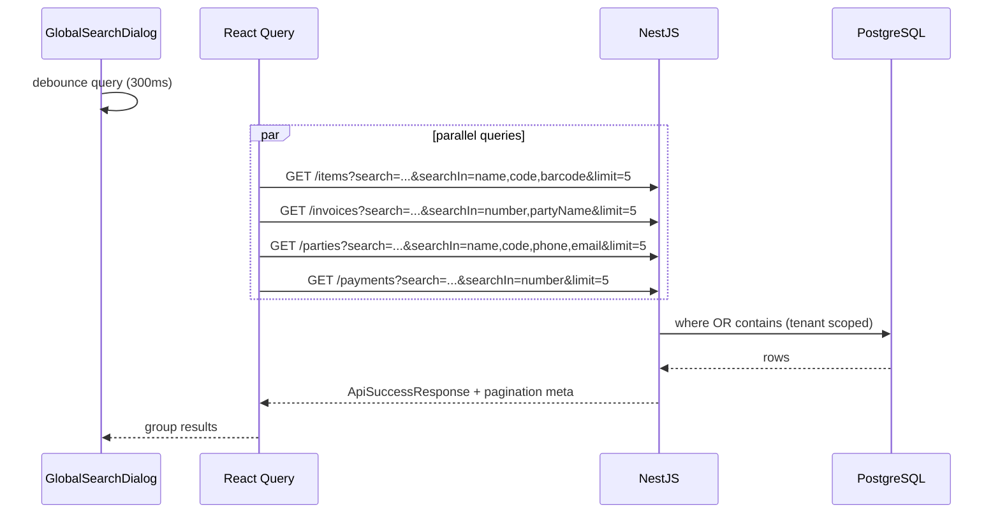

# Global Navbar Search (⌘K) — Design

**Date:** 2026-10-08
**Author:** opencode
**Status:** Approved
**Scope:** Dashboard header command palette + `GET /invoices` search support
**Primary goal:** Make the header ⌘K search functional — navigate permission-filtered static pages locally and find items, invoices, parties, and payments via parallel API queries.

---

## Context

- The header already owns a ⌘K `CommandDialog` shell with **static placeholder items** and no handlers:
  - `apps/dashboard/infrastructure/components/layout/dashboard/dashboard-header.tsx:200-212`
  - UI primitives: `apps/dashboard/shared/components/ui/command.tsx` (cmdk)
- Static nav pages are defined in `apps/dashboard/config/navGroups.tsx`; permission filtering exists in `apps/dashboard/config/filter-nav-groups.ts`. Labels are i18n keys (e.g. `business.navigation.items.dashboard`), resolvable via `useTranslations()` with no namespace (header already does this for `system.*`).
- Entity list endpoints:
  - `GET /items`, `GET /parties`, `GET /payments` — support `search` + `searchIn` via backend-core generic CRUD (`buildPrismaWhere`).
  - `GET /invoices` — **custom controller; ignores `search`/`searchIn`** (`apps/api/src/modules/invoicing/invoices/invoices.controller.ts:48-74`). The dashboard invoices list already sends `searchIn: ["number","partyName"]`, so its search box silently does nothing today.
- Client layer: `CrudClient.list(query?: Record<string, unknown>)` accepts arbitrary flat query params and serializes them (`packages/api-client/src/infra/client.ts`), so no OpenAPI regeneration is required for the palette. React Query v5 (`useCrudList`, `crudKeys`) is already wired in the dashboard.
- List item response fields (presenters):
  - items: `id, code, name, barcode`
  - invoices: `id, number, partyName, invoiceTypeDirection, status, total`
  - parties: `id, name, code, type, phone, email`
  - payments: `id, number, partyName, type, status, amount`
- Navigation targets: only items have a detail-ish route (`/catalog/items/[id]/edit`). Invoice/party/payment pages are list pages whose nuqs state reads `?search=` (`apps/dashboard/shared/data-view/table-view/search-params.ts`), so a filtered list URL is the best destination.

---

## Requirements

### Functional

- [ ] ⌘K / Ctrl+K opens the palette; dialog close, Esc, and click-outside work as today.
- [ ] Empty query → "Pages" group listing all static nav pages granted to the user.
- [ ] Pages filtered locally (case-insensitive, label and href).
- [ ] Query length ≥ 2 → parallel remote search (debounced 300 ms), 5 results per group:
  - Items — `searchIn: name,code,barcode`
  - Invoices — `searchIn: number,partyName`
  - Parties — `searchIn: name,code,phone,email`
  - Payments — `searchIn: number`
- [ ] Result selection closes the dialog and navigates:
  - Item → `/catalog/items/{id}/edit`
  - Invoice → `/sales/invoices?search={number}` or `/purchases/invoices?search={number}` (by `invoiceTypeDirection`)
  - Party → `/parties/customers?search={name}` (CUSTOMER / CUSTOMER_SUPPLIER) or `/parties/suppliers?search={name}`
  - Payment → `/finance/payments?search={number}`
  - Page → its `href`
- [ ] Loading and empty ("no results") states.
- [ ] Backend: `GET /invoices` honors `search` + `searchIn` (`number`, `partyName`) — this also fixes the existing invoices list search box.

### Non-functional

- [ ] Tenant isolation: all remote queries go through the existing authenticated API (tenant `where` already enforced).
- [ ] Permissions: entity groups are only queried/shown when the user has `items.view` / `invoices.view` / `parties.view` / `payments.view`; pages use `filterNavGroups`.
- [ ] i18n: en, ar, tr (new `system.header.search*` keys).
- [ ] RTL-safe (logical CSS only).
- [ ] No new dependencies (local debounce hook; cmdk, TanStack Query already present).
- [ ] Swagger/OpenAPI decorators updated for the new invoices query params.

---

## UX requirements

- Keyboard-first: cmdk arrow navigation + Enter selects; `shouldFilter={false}` so server results are never double-filtered client-side.
- Remote search only for whitespace-trimmed query length ≥ 2; below that only local pages show.
- One query per entity group, `staleTime: 30s`, `enabled` gated by permission and query length.
- Show a subtle "Searching…" row while any enabled query is fetching and there are no results yet.

---

## Proposed approach

### Option A (recommended) — parallel per-entity queries + local page filter

`GlobalSearchDialog` owns the input; a debounced value drives four `useCrudList` queries (one per entity, permission-gated), while static pages are filtered locally from `filterNavGroups(navGroups, user.permissions)`. cmdk filtering is disabled and groups are rendered explicitly.

**Why this option:** matches the user's suggestion ("fetch parallel queries with a local search for the nav links"), reuses the existing generic CRUD search stack, needs only a small invoices backend addition, and keeps each result group independently cacheable/gated.

### Option B (rejected) — unified `GET /search` backend endpoint

One round trip, but adds a new cross-domain API surface, a new DTO, presenter fan-out, and OpenAPI regeneration for no meaningful latency win at limit 5.

---

## Data flow



---

## File map

### Create

| Path | Purpose |
|------|---------|
| `apps/dashboard/infrastructure/components/layout/dashboard/global-search/global-search-dialog.tsx` | Palette UI: input, groups, rows, loading/empty states, navigation |
| `apps/dashboard/infrastructure/components/layout/dashboard/global-search/use-global-search.ts` | Debounced query + permission-gated parallel `useCrudList` calls |
| `apps/dashboard/infrastructure/components/layout/dashboard/global-search/static-pages.ts` | Flatten `navGroups` → searchable pages, permission-filtered, deduped |
| `apps/dashboard/infrastructure/components/layout/dashboard/global-search/use-debounced-value.ts` | Minimal debounce hook (no new dep) |

### Modify

| Path | Change |
|------|--------|
| `apps/dashboard/infrastructure/components/layout/dashboard/dashboard-header.tsx` | Replace static `CommandDialog` block with `<GlobalSearchDialog>`; keep ⌘K handler and trigger buttons |
| `apps/dashboard/shared/components/ui/command.tsx` | Export `CommandLoading` (cmdk `Command.Loading`) for the searching state |
| `apps/api/src/modules/invoicing/invoices/invoices.controller.ts` | Add `@Query('search')`, `@Query('searchIn')` + `@ApiQuery` decorators, pass through |
| `apps/api/src/modules/invoicing/invoices/invoices.service.ts` | Whitelist `number` → `number`, `partyName` → `party.name`; OR `contains` insensitive |
| `packages/i18n/src/en/system.json` | `header.searchGroups.{pages,items,invoices,parties,payments}`, `header.searching` |
| `packages/i18n/src/ar/system.json` | Same keys (Arabic) |
| `packages/i18n/src/tr/system.json` | Same keys (Turkish) |

### Delete

- None. (`system.header.quickActions` / `quickItems` keys become unused; removed as part of the i18n edit.)

---

## Layer details

### 1. Database

No schema changes. Invoice search hits `number` and the `party.name` relation with the existing tenant-scoped `where`.

### 2. API contracts

No DTO/resource changes. `InvoicesClient.list` already accepts arbitrary params; `invoices.resource.ts` already declares `searchIn: ["number","partyName"]`.

### 3. NestJS API

`InvoicesService.findAll` gains optional `search` / `searchIn`:

- Default `searchIn` = `number,partyName`; unknown keys ignored.
- `where.OR = [{ number: { contains, mode: 'insensitive' } }, { party: { name: { contains, mode: 'insensitive' } } }]` for whitelisted keys present.
- Controller passes the two new query params and documents them (`@ApiQuery`).
- Regenerate `packages/api-contracts/types` via `pnpm generate:dev` when the API can be run (types-only; not a build blocker).

### 4. API client

No changes.

### 5. Dashboard

- `static-pages.ts`: `{ labelKey, href, groupLabelKey }[]` flattened from `filterNavGroups(navGroups, permissions)`, sub-items preferred, deduped by href.
- `use-global-search.ts`: debounce 300 ms, min length 2, four `useCrudList` calls with `enabled` + `staleTime`; returns grouped, typed results plus `isFetching`.
- `global-search-dialog.tsx`: `<Command shouldFilter={false}>`; local page match always applied; remote groups rendered with `limit 5`; selecting runs `router.push(localizedHref(target))` then closes.
- `dashboard-header.tsx`: keeps `searchOpen` state, shortcut effect, and trigger buttons; body of the dialog is delegated to the new component.

---

## Verification

```bash
pnpm turbo run build --filter=@devloggers/api
pnpm turbo run build --filter=@devloggers/dashboard
pnpm generate:dev   # optional — API must be running
```

### Manual smoke test

- [ ] ⌘K opens; Esc closes; empty query shows permission-filtered pages only.
- [ ] Typing 2+ chars returns grouped items/invoices/parties/payments (only groups the user may view).
- [ ] Selecting each result type navigates to the right URL/locale.
- [ ] Invoices list search box now actually filters (number and party name).
- [ ] ar (RTL) and en render the palette and new labels correctly.

---

## Out of scope

- Recent searches / search history.
- Global search for other entities (categories, units, warehouses, …).
- Fuzzy/typo-tolerant backend matching.
- Changes to the per-list search UX.

---

## Open questions

- [ ] Items navigation target — **Decision:** open `/catalog/items/{id}/edit` (only record page) while other entity types land on filtered list pages. Alternative: filtered list for uniformity.
- [ ] Minimum remote query length — **Decision:** 2 characters.

---

## Approval

- [x] Design reviewed by: user (chat)
- [x] Approved on: 2026-10-08
